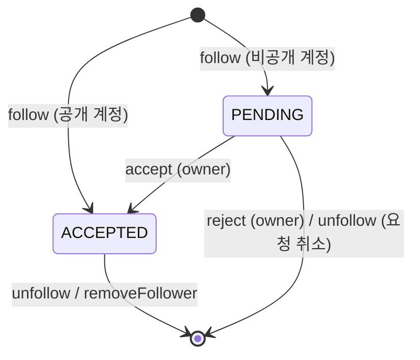

# clog-follow-spring

[clog-backend](https://github.com/miginho12/clog-backend)(FastAPI)의 **승인제 팔로우 상태 전이**를 Spring Boot + JPA + JUnit 5로 작게 다시 구현한 학습용 레포입니다.
알림 연동, 인증 같은 부가 기능은 빼고 상태 전이 규칙과 영속성만 남겼습니다.

## 스택

Java 17 · Spring Boot 4.1 · Spring Data JPA (Hibernate) · H2 · JUnit 5 / AssertJ / MockMvc

## 상태 전이



| 규칙 | 처리 |
|---|---|
| 자기 자신 팔로우 | 400 |
| 이미 관계가 있는데 follow | 새 row 없이 기존 상태 반환 (idempotent) |
| PENDING이 아닌데 accept / reject | 404 (요청 없음) |
| 관계가 없는데 unfollow / removeFollower | 204 (idempotent) |
| 팔로워 수 | ACCEPTED만 집계 |

## FastAPI 버전과 비교하며 배운 점

**1. 상태 전이 규칙의 위치: 쿼리 → 엔티티**

FastAPI 버전은 전이를 리포지토리의 조건부 UPDATE로 처리했습니다.

```python
update(Follow).where(..., Follow.status == "pending").values(status="accepted")
return result.rowcount > 0
```

Spring 버전에서는 전이 규칙을 엔티티 메서드가 갖도록 옮겼습니다. 허용되지 않은 전이는 엔티티가 직접 예외로 막습니다.

```java
public void accept() {
    if (status != FollowStatus.PENDING) {
        throw new InvalidFollowTransitionException(status, FollowStatus.ACCEPTED);
    }
    this.status = FollowStatus.ACCEPTED;
}
```

덕분에 규칙을 DB 없이 순수 단위 테스트(`FollowTest`)로 검증할 수 있습니다.

**2. Dirty checking: `save()`를 호출하지 않는 UPDATE**

`FollowService.accept()`는 엔티티를 조회한 뒤 `follow.accept()`만 호출합니다. 트랜잭션이 커밋될 때 Hibernate가 변경을 감지해 UPDATE를 보냅니다.
`FollowServiceTest.acceptPersistsViaDirtyChecking`에서 `flush()` + `clear()`로 1차 캐시를 비운 뒤 다시 조회해서, 메모리가 아니라 DB에 반영됐는지 확인합니다.

**3. 문자열 상태 → `enum` + `@Enumerated(STRING)`**

FastAPI 버전의 `Literal["pending", "accepted"]`는 enum으로 바꿨습니다. `ORDINAL`은 enum 순서가 바뀌면 기존 데이터의 의미가 달라지므로 `STRING`을 사용합니다.

**4. 예외 → HTTP 매핑 분리**

도메인 예외는 HTTP를 모릅니다. 상태 코드 변환은 `@RestControllerAdvice`에서 `ProblemDetail`(RFC 9457)로 일괄 처리합니다. FastAPI의 `exception_handlers.py`가 하던 역할입니다.

## 테스트

| 클래스 | 종류 | 검증 내용 |
|---|---|---|
| `FollowTest` | 순수 단위 (Spring 없음) | 초기 상태 결정, 전이 허용/거부 |
| `FollowServiceTest` | `@SpringBootTest` + H2, 테스트마다 롤백 | 영속성, idempotency, dirty checking, 예외 |
| `FollowControllerTest` | MockMvc | 승인 흐름 전체, 예외별 HTTP 상태 코드 |

```bash
./gradlew test
```

## 실행

```bash
./gradlew bootRun
```

`data.sql`이 사용자 3명을 넣습니다: alice(1, 공개), bob(2, 비공개), carol(3, 공개). 인증은 범위 밖이라 `X-User-Id` 헤더를 현재 사용자로 사용합니다.

```bash
# alice → bob(비공개) 팔로우 요청: PENDING
curl -X POST localhost:8080/users/2/follow -H "X-User-Id: 1"

# bob이 받은 요청 목록 확인 후 수락
curl localhost:8080/users/me/follow-requests -H "X-User-Id: 2"
curl -X POST localhost:8080/users/1/follow-request/accept -H "X-User-Id: 2"
```

| Method | Path | 설명 |
|---|---|---|
| POST | `/users/{id}/follow` | 팔로우 / 요청 |
| DELETE | `/users/{id}/follow` | 언팔로우 / 요청 취소 |
| GET | `/users/me/follow-requests` | 나에게 온 요청 목록 |
| POST | `/users/{requesterId}/follow-request/accept` | 수락 |
| POST | `/users/{requesterId}/follow-request/reject` | 거절 |
| DELETE | `/users/{followerId}/follower` | 내 팔로워 끊기 |

## 다음에 해볼 것

- 동시에 같은 팔로우 요청이 두 번 들어오면, 조회 후 삽입(check-then-insert) 사이에 경쟁이 생겨 unique 제약 위반이 납니다. `DataIntegrityViolationException`을 잡아 idempotent하게 처리하기
- `@DataJpaTest` 슬라이스 테스트로 리포지토리 쿼리만 따로 검증하기
- H2 대신 Testcontainers(PostgreSQL)로 원본과 같은 DB에서 테스트하기
